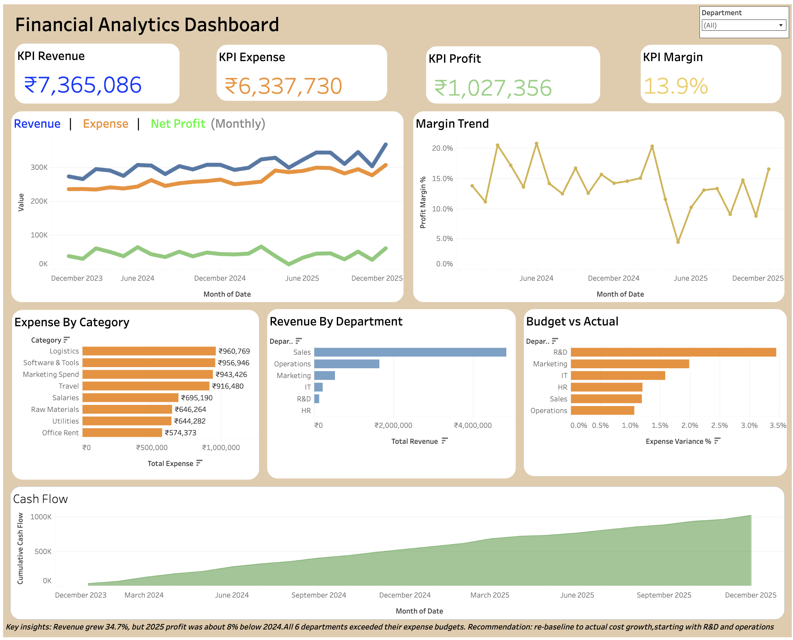
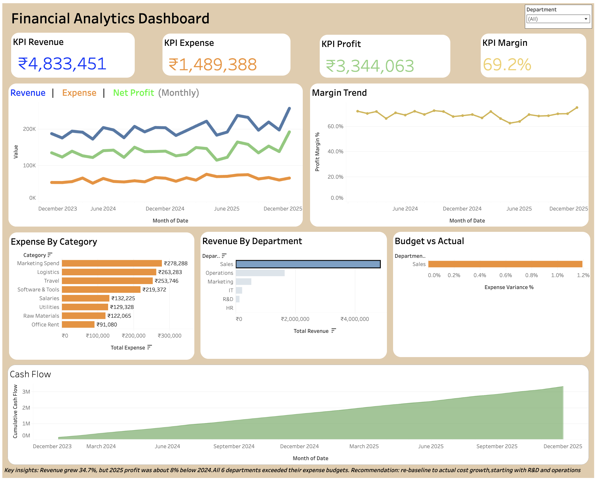
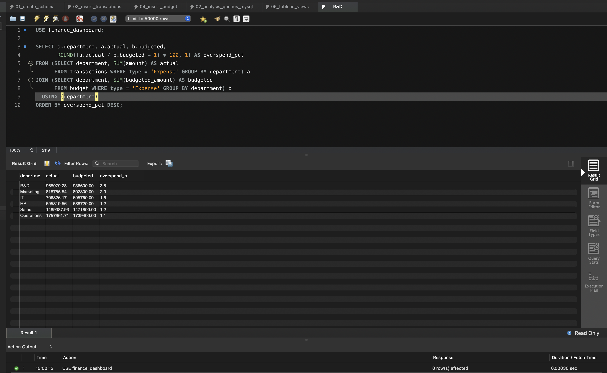

# Financial Analytics Dashboard

An end-to-end analytics project that tracks company-wide revenue, expenses, profit,
budget performance, cash flow and growth trends across 6 departments over 24 months.
Raw transactions go into **MySQL**, get analysed with **SQL** and **Python**, and are
visualised in an interactive **Tableau** dashboard.

## Problem Statement
Financial data usually sits in scattered spreadsheets, so basic questions take too long to
answer: *Are we profitable? Which departments overspend? Where is cash flow heading?*
This project builds the full pipeline, from raw transactions to a dashboard that answers
those questions in one place.

## Data Source
Synthetic dataset generated in Python (`data/generate_data.py`) to simulate 24 months
(Jan 2024 to Dec 2025) of financial activity across Sales, Marketing, Operations, R&D, HR
and IT, with growth, seasonality and budget variance built in. It contains **469
transaction rows** and **288 budget rows**. Swap in real data with the same schema and
the rest of the pipeline works unchanged.

## Tools Used
| Tool | Purpose |
|---|---|
| **MySQL** | Data storage and financial data extraction/analysis (9 analysis queries + 2 reporting views) |
| **Python** (Pandas, NumPy) | Data generation, cleaning, aggregation, exploratory analysis |
| **Matplotlib / Seaborn** | Exploratory charts and trend analysis |
| **Tableau** | Interactive dashboard: KPIs, trends, budget variance, cash flow,department filter |
| **Excel / CSV** | Data inspection and preprocessing |
| **GitHub** | Documentation and portfolio showcase |

An HTML/Chart.js preview (`dashboard/index.html`) is included so the dashboard concept can
be viewed instantly in any browser without installing anything.

## Key Insights
- Revenue grew **34.7%** (about ₹2.72 lakh to ₹3.67 lakh per month) over 24 months.
- Total revenue ₹73.65 lakh, total expense ₹63.38 lakh, net profit ₹10.27 lakh, an average profit margin of **13.9%**.
- **Logistics** is the largest expense category at 15.2% of total spend.
- **Profit did not grow:** expenses rose 30.4% against revenue's 34.7%, and 2025 net profit was about 8% below 2024.
- **Every department exceeded its expense budget in 10 to 15 of the 24 months** (Operations 15, IT/Marketing/R&D 13, HR 11, Sales 10). R&D has the largest overspend (3.5%). It is a systematic budgeting gap, not a one-off.
- **Recommendation:** re-baseline department budgets to actual cost growth (about 1.2% per month against about 0.9% assumed in the budgets), starting with R&D and Operations.

## How the Pieces Connect
```
generate_data.py -> transactions.csv + budget.csv
        |
MySQL tables (transactions, budget) -> SQL queries + 2 views
        |                                   |
CSV exports -> Tableau dashboard      Python notebook (Pandas, NumPy, Seaborn)
```
MySQL stores the data and answers the business questions, Python checks and explores it, and Tableau presents it. All three use the same data, so the totals match everywhere (revenue 7,365,086, expense 6,337,730).

## Project Structure
```
finance_project/
├── data/
│   ├── generate_data.py          # synthetic data generator
│   ├── transactions.csv          # 469 transaction records
│   ├── budget.csv                # 288 budget records
│   └── finance.db                # SQLite copy used for Python EDA
├── mysql_setup/
│   ├── 01_create_schema.sql      # database + tables (run first)
│   ├── 02_analysis_queries_mysql.sql   # 9 analysis queries
│   ├── 03_insert_transactions.sql      # loads 469 rows
│   ├── 04_insert_budget.sql            # loads 288 rows
│   ├── 05_tableau_views.sql            # views Tableau connects to
│   ├── ALTERNATIVE_CSV_IMPORT.md       # LOAD DATA method
│   └── SETUP_GUIDE.md                  # Mac setup, step by step
├── tableau_setup/
│   ├── TABLEAU_GUIDE.md          # full dashboard build guide
│   └── data/                     # CSVs ready for Tableau (Public or Desktop)
├── notebooks/
│   ├── eda_analysis.ipynb        # EDA notebook with charts and findings (opens on GitHub)
│   └── eda_analysis.py           # same analysis as a script, regenerates the chart images
├── sql/                          # SQLite versions of the queries
├── dashboard/index.html          # instant HTML preview
└── screenshots/                  # charts + key_insights.txt
```

## How to Run
1. Follow `mysql_setup/SETUP_GUIDE.md` (install MySQL, create the schema, load the data, create the views).
2. Run the analysis queries in `02_analysis_queries_mysql.sql`.
3. Follow `tableau_setup/TABLEAU_GUIDE.md` to build the dashboard.
4. Python EDA (needs Python 3): read `notebooks/eda_analysis.ipynb` on GitHub, or run it yourself:
```bash
pip3 install pandas numpy matplotlib seaborn jupyter
jupyter notebook notebooks/eda_analysis.ipynb     # run all cells
python3 notebooks/eda_analysis.py                 # or: regenerate the chart images
```

## Dashboard Highlights
- KPI cards: revenue, expense, net profit, profit margin
- Revenue, expense and profit trend; profit margin trend
- Expense breakdown by category; revenue by department
- Budget vs actual (expense variance % by department)
- Cumulative cash flow
- Department filter and click-to-filter

**Live dashboard:** [](https://public.tableau.com/app/profile/jayasurya.n7397/viz/FinancialAnalyticsDashboard_17930085857110/FinancialAnalyticsDashboard)



Filtered to one department (Sales):



## SQL Analysis (MySQL)
The `transactions` table has many rows per department per month, and the `budget` table has one row per department, month and type. They link on **date + department + type**. Transactions must be summed *before* joining to the budget, otherwise every budget row repeats once per transaction and the budget is inflated. The reporting view `vw_budget_vs_actual` does this, and the Tableau relationship uses the same three fields.

Featured query (expense vs budget by department; R&D comes out highest at about +3.5%):

```sql
SELECT a.department, a.actual, b.budgeted,
       ROUND((a.actual / b.budgeted - 1) * 100, 1) AS overspend_pct
FROM (SELECT department, SUM(amount) AS actual
      FROM transactions WHERE type = 'Expense' GROUP BY department) a
JOIN (SELECT department, SUM(budgeted_amount) AS budgeted
      FROM budget WHERE type = 'Expense' GROUP BY department) b
  USING (department)
ORDER BY overspend_pct DESC;
```



## Author
Jayasurya N · [GitHub](https://github.com/SURYAxO7) · [LinkedIn](https://linkedin.com/in/jayasurya-n07)
